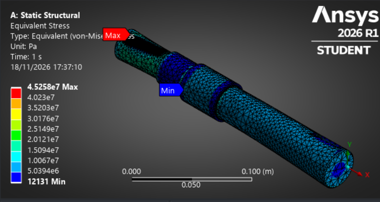
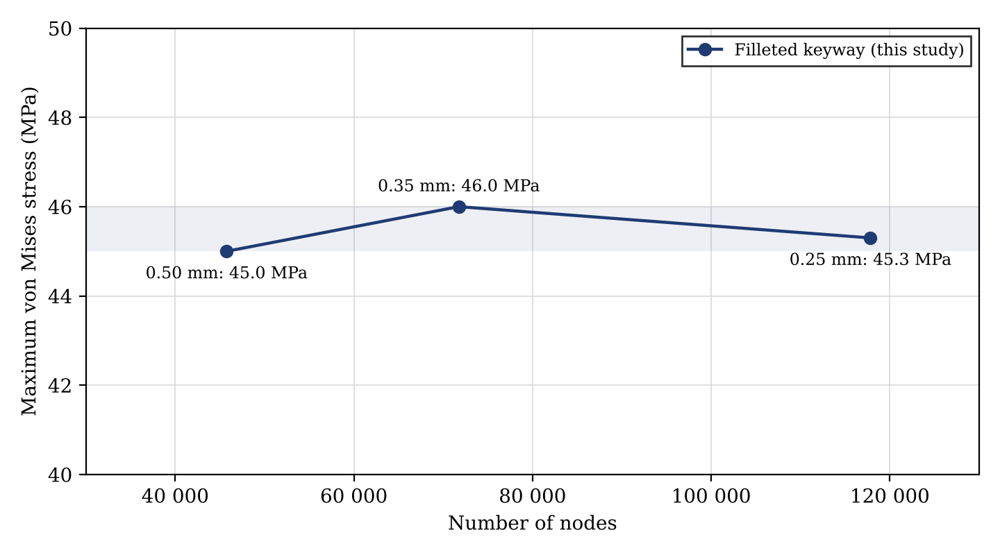
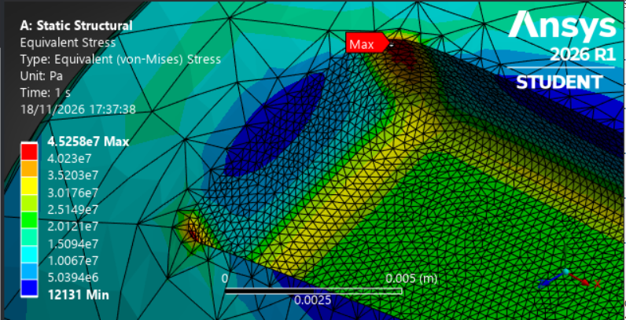
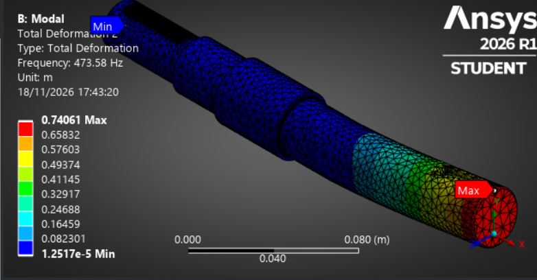

# Design and FEA of a Centrifugal Pump Shaft (SolidWorks + ANSYS Mechanical)

I designed the shaft for an HRZL IS100-80-125C centrifugal pump (80 m³/h, 12.5 m head, 2900 rpm, 8 kW diesel driver), sized it by hand, modelled it in SolidWorks, and checked it with static and modal finite element analysis in ANSYS Mechanical.

**Results:**
- Peak von Mises stress at the engine-end keyway: **45–46 MPa**, converged within ±2% over three meshes.
- Safety factor against yield (250 MPa): **about 5.4**.
- First bending natural frequency: **474 Hz**, about **9.8×** the 48.3 Hz running speed.
- Maximum deflection: **0.014 mm**.

Full report: [report/pump_shaft_fea_report.pdf](report/pump_shaft_fea_report.pdf)



## The shaft

| Section | Diameter | Position | Purpose |
| --- | --- | --- | --- |
| Engine end | 25 mm | 0–50 mm | Coupling, with keyway |
| Bearing seat 1 | 30 mm | 50–80 mm | Fixed (locating) bearing |
| Shoulder | 35 mm | 80–120 mm | Locates both bearings |
| Bearing seat 2 | 30 mm | 120–150 mm | Floating bearing |
| Overhang | 30 mm | 150–250 mm | Seal and impeller, with keyway |

Keyways are 8 × 4 mm (DIN 6885), with 1 mm fillets on the inside corners.

## Method

- **Hand calculations:** design torque 26.3 N·m at full engine power; radial hydraulic load 112 N plus impeller weight (150 N design); combined torsion and bending with shock factors gives a minimum diameter of 20.3 mm.
- **Static FEA:** two cylindrical bearing supports (bearing 1 fixed axially and in rotation, bearing 2 floating), equal and opposite 26.3 N·m torques, and a 150 N radial load on the overhang. Quadratic tetrahedral mesh with local refinement at the critical keyway.
- **Modal FEA:** same supports, impeller as a 3 kg point mass at the impeller centre (x = 230 mm), first six modes.

## Keyway mesh convergence

My first model had perfectly sharp keyway corners, and the peak stress kept rising with mesh refinement (25.1 → 32.8 → 50.5 MPa), which is a stress singularity. After I added 1 mm fillets, it converged:

| Keyway element size | Nodes | Max von Mises |
| --- | --- | --- |
| 0.50 mm | 45,754 | 45.0 MPa |
| 0.35 mm | 71,753 | 46.0 MPa |
| 0.25 mm | 117,832 | 45.3 MPa |



| Keyway stress | First bending mode (474 Hz) |
| --- | --- |
|  |  |

## Repository contents

```
├── report/      Full report (PDF and Word)
├── workbench/   Complete ANSYS Workbench project (static + modal)
├── geometry/    SolidWorks part and STEP file
├── results/     Convergence and modal data (CSV) and chart
└── images/      Stress, deformation, mesh and mode-shape plots
```

## Opening the files

You need ANSYS 2026 R1 or newer (the Student version works). Open `workbench/pump_shaft_fea.wbpj` in ANSYS Workbench, and keep the `.wbpj` file and the `pump_shaft_fea_files` folder together in the same folder.

## Limitations

- The impeller was not modelled. Its mass, position and radial load are assumptions, and it has no rotary inertia in the modal model.
- The bearings are rigid supports, which makes the model slightly stiffer than real bearings.
- The keys were not modelled, and no fatigue analysis was done.
- ANSYS Structural Steel was used instead of AISI 1045 data.

## Tools

SolidWorks · ANSYS Student 2026 R1 (Workbench, Mechanical)
